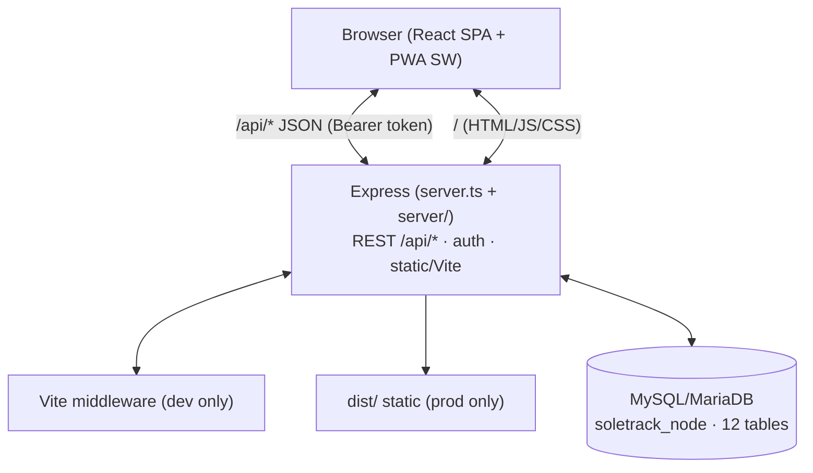
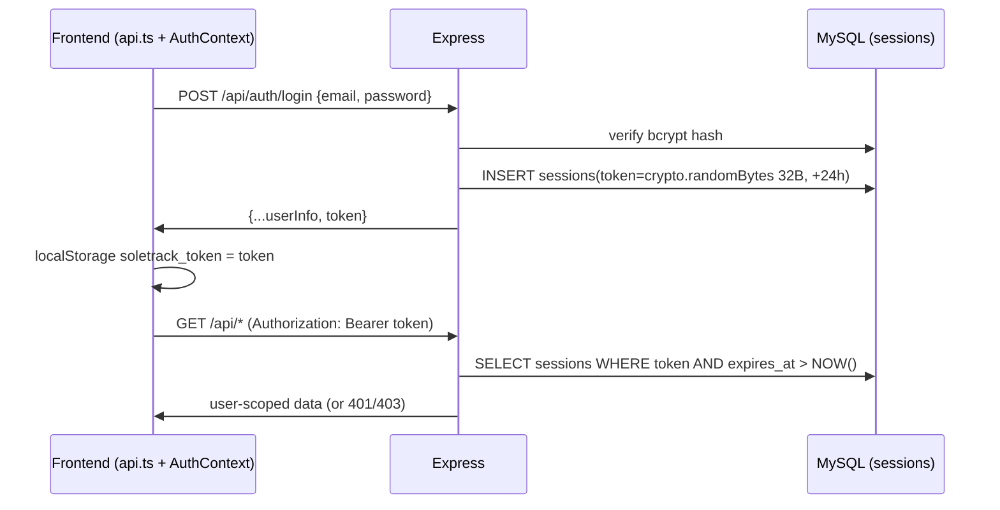

# Architecture

SoleTrack is a **single-process full-stack app**: one Node process runs Express,
which either mounts Vite middleware (dev) or serves `dist/` static (production),
and talks to MySQL/MariaDB via `mysql2/promise`.

## Request pipeline (per process)

1. `server.ts` → `initDb()` (bootstrap DB → `CREATE TABLE IF NOT EXISTS` ×12 → `seedData()`).
2. No permissive CORS middleware — same-origin serving in both modes (`server/app.ts`); cross-origin denied by default.
3. `app.use(express.json())`.
4. `/api/*` routes (public catalog → auth-gated cart/orders → `isSeller`/`isAdmin` branches), every handler wrapped in `asyncHandler` + central JSON error middleware.
5. Dev: `vite.middlewares`; Prod (`NODE_ENV=production`): `express.static(dist)` +
   PWA file routes (`/sw.js`, `/manifest.webmanifest`, `/workbox-*.js`) + SPA fallback `*`.

## Auth / token flow

Logout deletes the session row; expired rows are purged opportunistically on login
and at bootstrap. Session lifetime: 24h. No cookies, no refresh tokens.

## Roles & gates

- **Public:** `/api/health`, products, categories, sizes, stores.
- **Authenticated** (`getAuthenticatedUser`, `server/auth.ts`): cart, checkout,
  orders/my, orders/details (owner/seller/admin-scoped), reviews, payment/history.
- **`isSeller`** (`server/auth.ts`): role `seller` **and** `status === 'active'`.
  New seller registrations are `pending_approval` → blocked until admin activates.
- **`isAdmin`** (`server/auth.ts`): role `admin` only. Registration rejects `admin` role (allowlist `customer|seller`).

## Data flow notes

- Checkout is transactional (`BEGIN` → stock check → insert order/items/history →
  decrement inventory with `stock_quantity >= ?` guard → clear cart → `COMMIT`;
  rollback on any failure).
- Cancel is transactional too (customer-owned, `pending`/`confirmed` only):
  reread `order_items`, restock each line into `inventory`, then set
  `cancelled` + history row; terminal states reject with 400.
- Payment confirmation is transactional (`paid`/`refunded` allowlist): the
  owning seller (own-item check, 403 otherwise) or any admin marks the order;
  re-marking the same value succeeds idempotently without a duplicate
  history row.
- Reviews are verified: `POST /api/reviews` requires a `delivered` order
  containing the product and rejects a second review per `(product_id,
  user_id)` with 400 (`UNIQUE` key as backstop; legacy `user_id NULL` rows
  exempt).
- Soft deletes: `users.deleted_at`, `products.deleted_at`, `inventory.deleted_at`;
  categories/sizes are hard-deleted with in-use guards.
- PWA service worker caches catalog GETs (`NetworkFirst`, 10s timeout, 24h TTL) —
  fresh data when online, cache fallback offline; see `security-assessment.md`.
- `order_status_history` carries both lifecycle transitions and payment
  markers (`paid`/`refunded`); step-matching readers ignore the payment rows.
