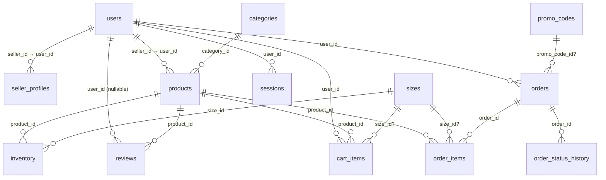

# Data Model

13 tables, created with `CREATE TABLE IF NOT EXISTS` in `initDb()` (`server/db.ts`),
seeded in `server/seed.ts`. InnoDB/utf8mb4. `orders.status` / `payment_status` are free-form `VARCHAR` (no ENUM).

## Tables (DDL summary)

- **users** (`user_id` PK): `username`+`email` UNIQUE, `password_hash` (bcrypt),
  `brand_name`, `first_name`, `last_name`, `role ENUM(customer,seller,admin)`,
  `status VARCHAR(20)` default `'active'` (`pending_approval` for new sellers),
  `deleted_at` (soft delete), `created_at`.
- **seller_profiles** (`seller_id` PK → `users`, CASCADE): `description`, `logo_url`,
  `banner_url`, `location`, `contact_email`, `phone`, timestamps.
- **categories** (`category_id` PK): `category_name`, `description`. Seed: Traditional,
  Woven, Casual, Eco-Friendly.
- **sizes** (`size_id` PK): `size_value`. Seed: 5–12.
- **products** (`product_id` PK → sellers, categories): `seller_id`, `category_id`,
  `product_name`, `description`, `base_price DECIMAL(10,2)`, `image_url TEXT`,
  `status` default `'active'`, `deleted_at`, `created_at`. Seed: 15 products across 4 sellers.
- **inventory** (`inventory_id` PK): `product_id`, `size_id`, `stock_quantity`,
  `deleted_at`. Seed: 4 sizes/product (7–10) with per-product stock map.
- **reviews** (`review_id` PK): `product_id`, `user_id` NULL (SET NULL),
  `customer_name` (denormalized display name), `rating`, `comment`, `created_at`.
  `UNIQUE(product_id, user_id)` (`uq_reviews_product_user`) enforces one review
  per user per product; multiple `NULL` `user_id` rows are allowed, so the 10
  legacy seed reviews are unaffected. Application rule: only a `delivered` order
  containing the product may be reviewed. Seed: 10 reviews.
- **cart_items** (`cart_item_id` PK): `user_id`, `product_id`, `size_id` NULL,
  `quantity`, `created_at`. Uniqueness is application-level (upsert query), no DB constraint.
- **orders** (`order_id` PK): `user_id`, `total_amount`, `shipping_fee`,
  `status` default `'pending'` (pending/confirmed/shipped/delivered/cancelled by
  convention, plus `requested`/`approved` for the returns flow),
  `payment_status` default `'unpaid'` (`unpaid` initial; owning seller or any admin
  may mark `paid`/`refunded`, idempotent on re-mark; cancel and return-approval
  append `refunded` only when the order was `paid`), `promo_code_id` NULL (no FK — promos stay deletable),
  `discount_amount DECIMAL(10,2)` default `0`, `shipping_address TEXT`,
  `payment_method`, `created_at`. Seed: 12 orders for the demo customer
  (non-cancelled orders seeded `paid` with a `paid` history row).
- **order_items** (`order_item_id` PK): `order_id`, `product_id`, `size_id` NULL,
  `quantity`, `price_at_purchase` (snapshot).
- **order_status_history** (`history_id` PK): `order_id`, `status`, `created_at`.
  Carries both lifecycle transitions (`pending` → … → `delivered`/`cancelled`,
  plus `requested` → `approved` for returns)
  and payment markers (`paid`/`refunded`); readers that match step names
  (e.g. order tracking) ignore the payment rows.
- **promo_codes** (`promo_code_id` PK): `code VARCHAR(50)` UNIQUE (stored
  uppercase), `discount_type ENUM('percent','fixed')`, `discount_value
  DECIMAL(10,2)`, `min_subtotal` default `0`, `expires_at` NULL (never expires),
  `usage_limit` NULL (unlimited), `used_count` default `0` (incremented once per
  discounted order inside the checkout transaction), `is_active`, `created_at`.
  Seed: `WELCOME10` (10% off, no minimum, 500 uses, expires in a year).
- **sessions** (`token VARCHAR(64)` PK): `user_id` (CASCADE), `expires_at`, `created_at`.
  Token = 64 hex chars (`crypto.randomBytes(32)`), 24h TTL, purged when expired.

## Integrity notes

- FKs exist on most relations (`cart_items` → users/products/sizes,
  `order_items` → orders/products/sizes, `orders` → users; no `CASCADE`
  semantics) but **no FK** from `orders.promo_code_id` (promos stay hard-deletable);
  deletes rely on soft-delete + app checks.
- No unique constraint on `(user_id, product_id, size_id)` in `cart_items` — duplicates
  possible under race (upsert is read-then-write, no transaction). `reviews` **is**
  constrained (`UNIQUE(product_id, user_id)`).
- `orders.status`/`payment_status` are `VARCHAR` without schema-level ENUMs —
  the status lifecycle and the `paid`/`refunded` payment allowlist are enforced
  in route logic, not the schema.
- Monetary math uses `DECIMAL(10,2)` in schema, cast to `DOUBLE` in reporting queries
  (precision fine for academic scale; note for roadmap).
